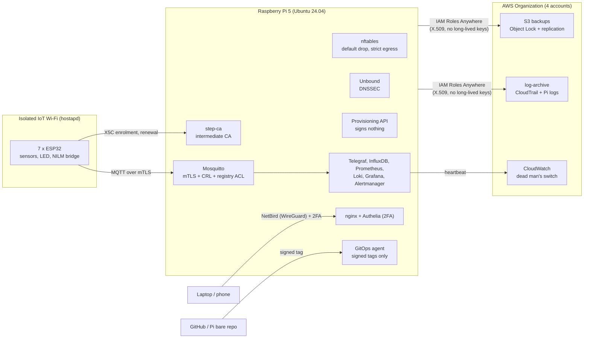

# HomePi — an edge IoT platform run like production

A Raspberry Pi 5 that runs an isolated IoT network, a private PKI for ESP32 devices, a full
observability stack and signed OTA updates, configured entirely from this repository through
**pull-based GitOps with signed tags**, and backed by a **four-account AWS organization**.

It is a one-node home platform. It is built and operated with production rules: every change goes
through Git, every control is checked, every incident gets a write-up, and every limit is written
down.

📝 Article series (Japanese, Qiita): https://qiita.com/LouisAndreN/items/efdde9e36d1fd39f9991

## Architecture



## What is in it

| Area | Implementation | Where |
|---|---|---|
| Network isolation | Dedicated IoT Wi-Fi, nftables default drop, egress limited to HTTPS/HTTP/ICMP, NAT | `ansible/roles/network` |
| DNS | Unbound as system resolver, DNSSEC, split views for LAN and NetBird | `ansible/roles/dns` |
| Remote access | NetBird (WireGuard) with ACLs, SSH keys only, no port open to the Internet | article 3 |
| Device identity | Manufacturer CA (offline) issues IDevIDs; step-ca X5C provisioner with a template that binds the LDevID name to the IDevID (IEEE 802.1AR model) | `ansible/roles/pki` |
| MQTT | Mosquitto mTLS on 8883, CRL enforced, ACL generated from the device registry | `ansible/roles/pki_crl`, `mqtt_acl` |
| Enrolment | Zero-touch for pre-announced devices; unknown devices stay pending; the API holds no CA secret | `apps/api` |
| OTA | Signed images, staged rollout with canary and abort | `ansible/roles/ota_rollout` |
| Observability | 104 Prometheus rules in 17 files with promtool unit tests, Loki with bounded labels, InfluxDB with per-consumer tokens, Grafana on a unix socket | `ansible/roles/observability_core`, `alloy`, `influxdb`, `grafana` |
| Alerting | Slack routing by severity, plus an independent dead man's switch: Watchdog → CloudWatch → e-mail | `terraform/aws/homepi/heartbeat.tf` |
| Intrusion detection | CrowdSec + nftables bouncer, auditd rules scoped to login sessions | `ansible/roles/crowdsec`, `auditd` |
| Web access | nginx as the only entry point, Authelia password + TOTP, per-path source allow lists | `ansible/roles/nginx`, `authelia` |
| GitOps | Pull model: the Pi applies only signed tags from a trusted key, hourly drift check, release gate; nginx, Alloy, Authelia and the dashboard roll back automatically when their checks fail | `ansible/roles/gitops_runtime` |
| AWS | Organization with management, workload, log-archive and backup-vault accounts; SCP guardrails; organization CloudTrail; cross-account backup vault; budget | `terraform/aws` |
| Backups | Nightly state archive and native InfluxDB backup, weekly line-protocol export, hourly sensor delta (RPO 1 h), all age-encrypted on the Pi and uploaded to S3 | `ansible/roles/homepi_tools`, `docs/disaster-recovery.md` |
| Disaster recovery | One-command restore orchestrator from a blank disk (phases timed in `timeline.tsv`), rehearsed twice by removing the production disk | `scripts/restore`, `docs/runbooks/restore.md` |

33 Ansible roles, applied by `ansible/site.yml`. Roles marked *verify only* never write
boot-critical or network files: they fail the run on drift, and a human applies the change.

## Design decisions

| Decision | Rejected alternative | Why |
|---|---|---|
| Pull-based GitOps, signed tags only | Push from CI with SSH keys | The Pi exposes nothing and holds no CI credential; an unsigned or rewritten tag is refused |
| Two CAs: offline Manufacturer CA for IDevIDs, step-ca on the Pi for LDevIDs | One CA on the Pi | A compromised Pi cannot mint a new "genuine" device |
| The provisioning API signs nothing | API signs CSRs with the CA password | Every API vulnerability would have been a CA vulnerability |
| Dead man's switch outside the Pi | Alerting only from the Pi | On 2026-11-01 the Pi's own DNS failure blocked 79 of 101 Slack notifications |
| IAM Roles Anywhere with X.509 | Access keys on the Pi | No long-lived AWS secret on an edge device |
| Grafana on a unix socket | `127.0.0.1:3000` behind nginx | Loopback is not a boundary: any local user could send the auth-proxy header and become admin (reproduced as `nobody`) |
| No eFuse features on the ESP32 (Secure Boot, flash encryption) | Burn eFuses | Irreversible on prototype hardware; the risk is accepted and documented |

## Incidents and drills

Written up in `docs/incidents` and `docs/game-days`, and in the articles.

- **2026-11-01, inode exhaustion.** Unbounded Loki labels created about a million stream
  directories and used every inode of `/var` while 27% of the space was free. DNS (3,323 Unbound
  restarts), login and alert delivery failed together; no alert reached a human. Fixes: bounded
  labels, Loki on its own XFS volume, inode alerts, the off-Pi dead man's switch.
- **2026-11-15, CRL rejected every device for about 3 minutes.** step-ca always adds an Issuing
  Distribution Point, so OpenSSL refused every client certificate once the broker read the CRL.
  The safeguard counted devices by `last_seen`, which stale values satisfied. Fix: the CRL is
  verified, re-signed without the IDP and installed only if a valid certificate still passes.
- **Re-enrolment loop.** Old firmware discarded its certificate after three MQTT disconnects:
  232 certificates signed in one day. Fixed in firmware; broker restarts now cause 0 signatures,
  and an alert fires on enrolment bursts.
- **2026-11-22/23, provisioning API down about 9 hours.** A security upgrade rebuilt the API
  virtualenv under the GitOps umask (077): the API user could not read it. The rollback worked, but
  the failing tag was retried every 10 minutes, and the database side files disappeared overnight.
  Detected in 12 minutes, nobody acted before the morning. Telemetry was not affected. Fixes:
  umask 022, side files first, a direct `HomepiApiDown` alert, restart counters in node_exporter.
- **Full rebuild game days.** The production NVMe is removed and the Pi rebuilt on a spare disk
  from this repository and the S3 archives only. C3 (2026-11-21): 5 h 18 min, 44 defects. C4
  (2026-11-22): 4 h 24 min, 17 defects, sensor data loss 54 min. Both **FAIL** the 4-hour target
  and are published as such. C5 (2026-11-24): **1 h 03 min**, sensor data loss 29 min, 3 defects,
  one fixed during the drill, so it is published as **not clean**; 1.0.0 waits for a clean run (C6).
- **Other drills:** dead man's switch (twice), drift detection, controlled reboot without manual action.

## Known limits

The full list is in `docs/known-limits.md`. The main ones:

- **Single node.** No high availability: a dead disk is a full rebuild (see the game days above;
  measured 1 h 03 min in C5, target 4 h).
- **Disk encryption does not protect against theft.** The data volume is LUKS2, but for a
  headless boot its key file sits on the unencrypted root partition
  (`docs/runbooks/disk-encryption.md`).
- **Device keys in plain flash.** IDevID keys are readable with physical access (no eFuse, see
  above); device certificates live one year.
- **Not everything is managed yet.** A few units and files are still adopted by hand; they are
  listed in the docs.

## How this project is built

The code, the scripts and most of the diagnostics in this repository are written with Claude
(Anthropic's AI model), which is why many commits show `Claude` as author. I (Louis) decide the
architecture and the scope, approve every change that reaches production (a typed confirmation to
merge, then a release tag signed with my key), do the physical operations, and run and check the
game days. Nothing reaches the Pi without passing the Pi's own check-mode precheck and a signed tag.

These guardrails exist because an AI makes mistakes like anyone else: the 2026-11-22 API outage
came from AI-written code, and the rollback, the precheck and the alerts are what limited it. The
incident reports say which mistakes were whose.

## Repository layout

```
ansible/     roles, site.yml (GitOps entry point), storage.yml (manual), SOPS secrets
apps/        provisioning API (Python), NOC dashboard (React)
terraform/   AWS organization, logging, backup vault, Pi edge resources, Grafana
scripts/     restore phases, nftables apply, controlled reboot, helpers
docs/        runbooks, incidents, game days, ADRs, disaster recovery, known limits, versioning, roadmap
```

Secrets are committed only as SOPS files encrypted with age. Tokens and passwords never go
through command-line arguments: environment files read by systemd, 0600 files or stdin.

## Status

Running in production at home since 2026. Releases are signed tags; the version rules, and what 1.0.0
requires, are in `docs/versioning.md`. Device firmware is in a separate repository:
https://github.com/LouisAndreN/homepi-firmware

## License

Apache License 2.0, see [LICENSE](LICENSE).
